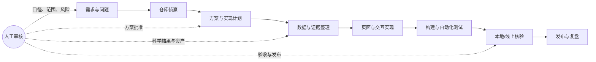

# FoldBridge

FoldBridge 是一个面向 RNA 探针数据、结构数据和证据解释的静态 Web 工作台。项目把 RMDB / RASP / PDB 等来源整理成可浏览的页面，并提供 Browse、Sequence、Structure、Probing、Stats、Search、Case 和 ANNOJOIN Atlas 等入口。

本文除了介绍如何运行项目，也记录本仓库采用的 AI 协作方式：先由人确定问题、数据口径和验收标准，再让 AI 负责检索上下文、拆解任务、生成或修改代码、整理数据和执行验证；涉及科学口径、线上资产和发布的决定始终由人审核。

## 1. 整体 AI 协作 Pipeline

项目的工作流可以概括为：



每一轮迭代都保留四类信息：**输入是什么、AI 做了什么、人工检查什么、最后产出了什么**。这样可以追踪一个页面或数据文件从需求到线上结果的完整链路，也能在出现 404、数据缺失或页面回归时回溯责任边界。

## 2. Pipeline 各环节中 AI 的具体工作

### 2.1 需求拆解：把自然语言变成可验收任务

**输入：** 用户对页面、数据、指标或线上问题的描述。

**AI 的工作：**

- 识别需求涉及的页面、脚本、数据文件和发布目标。
- 把大任务拆成有明确输入和输出的子任务。
- 主动标出需要确认的范围，例如“只改 UI”还是“重建数据”，“本地验证”还是“发布线上”。
- 将成功标准写成可以运行的测试、构建命令或人工核验清单。

**人工把关：** 确认研究问题、数据口径、优先级和发布边界。AI 不自行扩大数据范围，也不把讨论中的假设当成事实。

**输出：** 任务说明、验收条件，以及必要时的设计文档和实现计划。仓库中的 `docs/superpowers/specs/` 与 `docs/superpowers/plans/` 保存了多轮功能的设计和执行记录。

### 2.2 仓库侦察：建立代码、数据和部署地图

**输入：** 现有仓库、Git 历史、测试、部署文档和线上问题。

**AI 的工作：**

- 阅读目录、入口文件、构建脚本和测试，定位真实的数据流，而不是只看文件名猜测。
- 通过 Git 历史和差异确认某个文件为何存在、由哪个构建步骤生成、是否属于发布产物。
- 画出 SPA、Case 页面、共享资产、生产源和备份之间的依赖关系。
- 在修改前记录基线状态，避免把工作区里已有的未提交变更误当成自己的结果。

**人工把关：** 确认哪些资产是生产源、哪些是派生物，确认可以修改的分支、目录和服务器。

**输出：** 影响范围、文件清单和风险点。线上资产与排障规则见 [`docs/网站更新手册_DEPLOYMENT_HANDBOOK.md`](docs/网站更新手册_DEPLOYMENT_HANDBOOK.md)。

### 2.3 数据与证据整理：让每个页面都有可追溯输入

**输入：** RMDB / RASP / PDB 数据、RNA 探针文件、结构文件、Case 资产和外部生成结果。

**AI 的工作：**

- 编写或调整解析、转换、索引和汇总脚本，把原始数据变成页面使用的 JSON、CSV、压缩分片或结构文件。
- 处理链标识、残基编号、DBN 配对、SASA、空间接触和置信度分层等数据契约。
- 通过清单、计数、哈希、抽样和逐条比对检查缺失、错配和重复。
- 把数据来源、转换步骤、限制条件和已知缺口写入文档，便于后续复核。

**人工把关：** 决定科学定义和取舍。例如，配对来源、链映射、阈值、置信度等级以及“缺失”与“不可评估”的区别，都必须由项目负责人确认。

**输出：** 可被前端读取的静态资产、生成脚本、校验报告和审计记录。相关背景可参考 [`FOLDBRIDGE_CASE_WORK_AND_ASSET_AUDIT_20260827.md`](FOLDBRIDGE_CASE_WORK_AND_ASSET_AUDIT_20260827.md) 与 [`FOLDBRIDGE_GAP373_BACKFILL_PLAN_20260827.md`](FOLDBRIDGE_GAP373_BACKFILL_PLAN_20260827.md)。

### 2.4 页面与交互实现：把数据契约变成可解释界面

**输入：** 已确认的数据结构、页面目标、视觉约束和现有组件。

**AI 的工作：**

- 在现有 ES module 结构中修改控制器、Store、View 和样式，尽量保持组件边界和已有路由稳定。
- 实现搜索、筛选、表格、1D / 2D / 3D 预览、下载和 Case 工作台等交互。
- 为空数据、缺失资产、加载失败、链映射冲突和低置信度结果提供明确状态。
- 根据页面截图或浏览器检查结果修正布局、滚动、iframe 高度和移动端行为。

**人工把关：** 判断页面是否准确表达数据含义，确认文案不会夸大证据强度，并验收关键路径和可访问性。

**输出：** `src/` 中的页面逻辑、数据 Store、视图组件、样式和对应测试；静态生成结果进入 `dist/` 或 `_site/`。

### 2.5 测试与验证：从“代码能跑”到“结果可信”

**输入：** 修改后的代码、生成资产和既定验收标准。

**AI 的工作：**

- 先运行针对性测试，再运行完整测试集，定位失败属于代码、数据、环境还是基线问题。
- 检查路由、构建产物、资源引用、Pagefind 搜索索引和 Atlas smoke test。
- 对关键数据执行数量、覆盖率、链身份和文件可达性校验。
- 在声称完成前保留命令和输出，避免只依据代码阅读下结论。

**人工把关：** 复核测试是否覆盖真正的风险，抽查真实页面和代表性数据，并决定是否接受已知限制。

**输出：** 测试结果、构建产物、验证报告和必要的回归修复。

### 2.6 发布与复盘：把变更安全地送到线上

**输入：** 已通过验证的提交和明确的发布目标。

**AI 的工作：**

- 按发布流程生成静态站点，检查 GitHub Pages 工作流和发布分支。
- 对线上 URL、Case 页面、共享资产和 API 入口做可达性核验。
- 记录变更、回滚点、遗留缺口和事故原因，更新部署手册或审计文档。

**人工把关：** 批准写入生产源、选择发布时机，并在发布后确认线上内容符合预期。AI 不绕过权限，也不把“本地构建成功”当作“线上已发布”。

**输出：** Git 提交、GitHub Pages 产物、线上核验记录和后续任务。

## 3. 本地运行与验证

### 3.1 环境要求

- Node.js 运行时。
- npm。
- 如果运行 ANNOJOIN Atlas，需要准备对应的只读数据目录，并通过环境变量挂载。

### 3.2 安装、测试与构建

```bash
npm ci
npm test
npm run build:annojoin-atlas
npm run build
npm run verify:mvp
npm run verify:annojoin-atlas -- --sample-size 20
```

启动本地服务：

```bash
npm run serve -- --port 8080
```

浏览器打开 <http://127.0.0.1:8080/dist/>。

### 3.3 Docker 与发布产物

```bash
docker compose up --build
```

默认访问 <http://localhost:8081/dist/>。ANNOJOIN Atlas 入口为 `/#annojoin-atlas`。生成 GitHub Pages 发布目录：

```bash
npm run build:pages
```

该命令把可发布静态文件写入 `_site/`。`dist/` 和 `_site/` 都是生成目录；源数据和页面逻辑分别位于 `src/assets/data/` 与 `src/`。

## 4. 仓库地图

| 路径 | 用途 |
| --- | --- |
| `src/` | SPA 页面、控制器、Store、视图和前端逻辑 |
| `src/assets/data/` | RMDB、探针、帮助页和统计等运行时数据 |
| `public/` | Case 页面及其静态共享资产 |
| `scripts/` | 构建、索引、统计、服务和验证脚本 |
| `test/` | Node.js 测试与页面契约测试 |
| `docs/` | 数据契约、设计计划、交接记录和部署手册 |
| `.github/workflows/` | GitHub Pages 与发布自动化 |
| `dist/`、`_site/` | 本地构建和发布生成物 |

## 5. AI 协作的边界与原则

1. **事实优先。** AI 可以总结和组织证据，但不能凭空补齐缺失数据。
2. **人审口径。** 科学定义、数据来源、阈值和线上写入范围由人批准。
3. **可复现。** 重要结果必须对应脚本、命令、提交或审计记录。
4. **小步修改。** 先定位影响范围，再做局部变更；生成资产与源文件分开核验。
5. **证据后结论。** 只有完成测试、构建和线上核验，才能声称功能或修复完成。

## 6. 相关文档

- [网站更新手册](docs/网站更新手册_DEPLOYMENT_HANDBOOK.md)：部署、资产位置、Case 数据流和排障流程。
- [Case 工作、资产与事故审计](FOLDBRIDGE_CASE_WORK_AND_ASSET_AUDIT_20260827.md)：历史工作、资产和线上事故的复盘。
- [gap373 缺页回填计划](FOLDBRIDGE_GAP373_BACKFILL_PLAN_20260827.md)：缺页调查、分阶段回填与验收约束。
- [`docs/superpowers/specs/`](docs/superpowers/specs/)：功能设计记录。
- [`docs/superpowers/plans/`](docs/superpowers/plans/)：实现计划记录。

